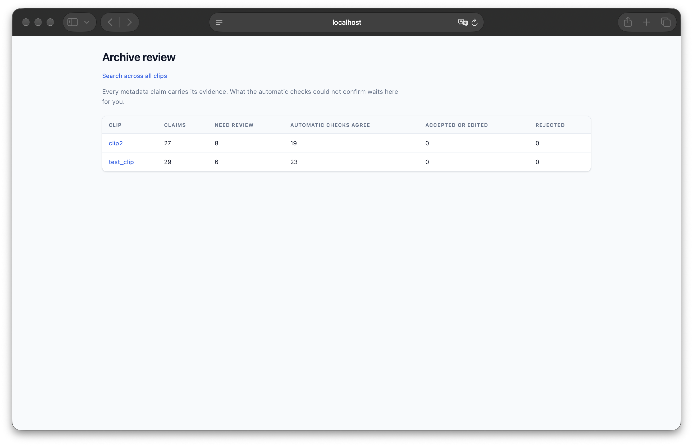
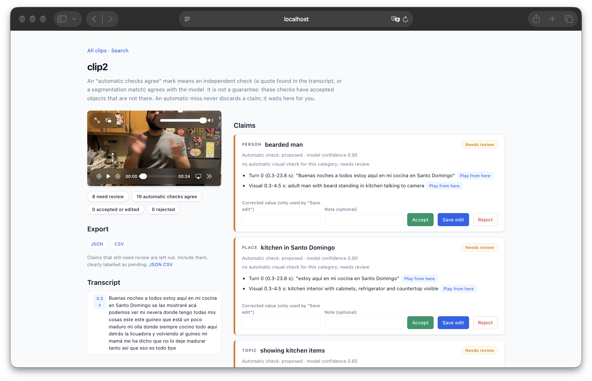
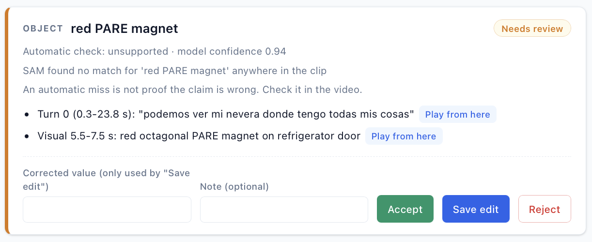
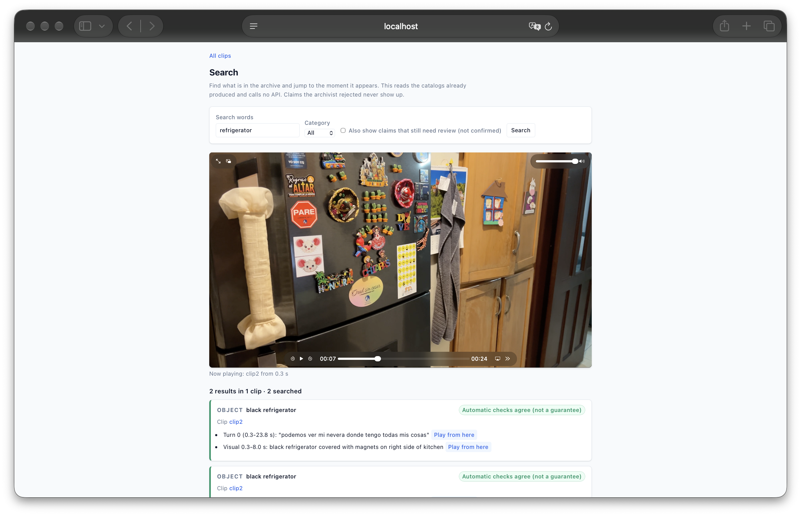
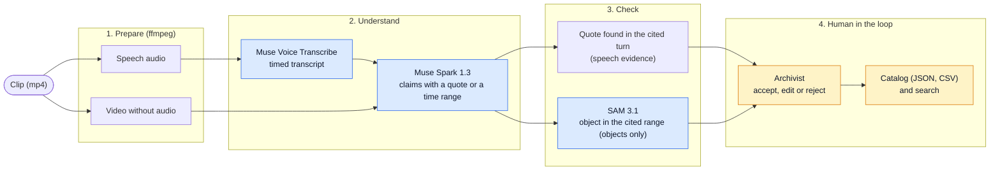
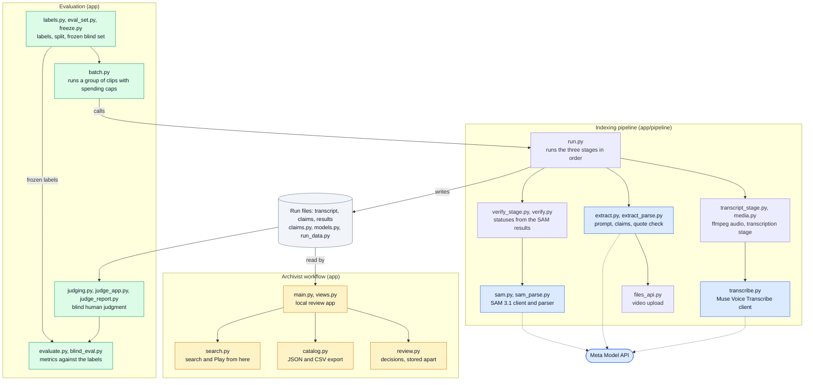

# verifiable-archive-indexer

Indexes Spanish-language video and attaches to every metadata claim the evidence
behind it, so an archivist can check the claims in seconds and decide what to
trust. Built for the Meta Global AI Developer Hackathon (Indie track).

The point is not that the model is always right. It is that nothing it says
travels without a quote from the transcript or a time range in the video, that
independent checks run on it, that what the checks cannot confirm waits for a
human, and that the system reports how well it did, including what did not work.

## Demo video

[Watch the demo (2:21) on YouTube](https://www.youtube.com/watch?v=y62l2ED6P28)

## Screenshots



*The clip list: claims per clip, how many wait for review, and how many the automatic checks agree on.*



*A clip page: the video, the counters, and every claim with its state and its evidence. "Play from here" jumps to that second.*



*A claim the automatic check could not confirm: no segmentation match was found for a magnet that is really on the fridge. A miss never discards a claim; it waits here for the archivist.*



*Search across the archive: type a word, see where it appears, and play the video from that second.*

## What it does

1. **Transcribe.** Speech is transcribed turn by turn, with timestamps.
2. **Extract.** A vision model watches the silent video together with the
   transcript and proposes claims about people, places, topics, scenes and
   objects. Every claim must carry evidence: an exact quote from a transcript
   turn, or a time range in the video. The parser rejects claims without it.
3. **Check, without trusting the model.**
   - Speech evidence is accepted only if the quote really occurs in the cited turn.
   - For objects, a segmentation model is asked whether the concept appears inside
     the cited time range (at least 2 frames with confidence 0.5 or more, on a
     5 fps copy of the video).
   - Result: `checks agree`, `disputed`, `unsupported`, or still `proposed`.
     A miss never discards a claim: it goes to human review. Places, people,
     scenes and topics are not checked automatically.
4. **Review.** A local web app lists what needs review first. Each claim shows its
   evidence with a button that plays the video from that moment. The archivist
   accepts, edits or rejects; every decision is stored with a timestamp, apart
   from the pipeline output.
5. **Export.** A catalog in JSON and CSV that says where each entry came from
   (automatic checks, archivist, or still pending). Rejected claims are left out;
   pending ones are left out unless requested and then labelled.
6. **Measure.** Tools to compare runs against hand-made labels and against a human
   judgment of every object claim (see "Results" and the evaluation protocol).

"Checks agree" means independent automatic checks agree with the model. It does
not mean the claim is correct. The interface and the catalog say so.

## How it fits together

Data flow, with the Meta model used at each step:



Modules and the files they live in:



A more detailed map, generated automatically from the repository by [GitDiagram](https://gitdiagram.com/jorgedoiany/verifiable-archive-indexer), is in [`docs/images/module-map.png`](docs/images/module-map.png) (open it at full size).

## Meta models used

| Model | Used for | Where in the code |
| --- | --- | --- |
| Muse Voice Transcribe (`muse-voice-transcribe-1.0`) | Turn-level transcription, Spanish | `app/pipeline/transcribe.py` |
| Muse Spark 1.3 (`muse-spark-1.3`) | Watches the silent video and proposes claims with evidence | `app/pipeline/extract.py` |
| SAM 3.1 (`sam-3.1`) | Checks whether an object concept appears in the cited range | `app/pipeline/sam.py` |
| Muse Wonder (`muse-wonder-1.0`) | A second, blind verifier, tried as an experiment only; not part of the pipeline | `app/pipeline/arbiter.py` |

Calls go to the Meta Model API: `POST /v1/asr/transcribe`, `POST /v1/responses`
and the Files API (`app/pipeline/files_api.py`).

## Results

Measured on 9 blind clips of 20 seconds, all recorded by the author (one speaker,
Dominican Spanish; labels were written before the pipeline ran on them and their
hashes are in `docs/blind-manifest.json`). Everything below comes from one run per
variant. Read the limits first.

| | Basic prompt | Inventory prompt (default) |
| --- | --- | --- |
| Object claims proposed | 27 | 162 |
| Labeled objects covered, by name | 21.0% (13 of 62) | 62.9% (39 of 62) |
| 95% interval of that coverage | 12.7% to 32.6% | 50.5% to 73.8% |
| Object claims judged visible in the cited range | 27 | 147 |
| Judged not visible | 0 | 2 |
| Judged unsure | 0 | 13 |
| Visible, but with a wrong detail (color or material) | 2 | 10 |
| Precision over decided claims | 100% (27 of 27) | 98.7% (95.2% to 99.6%) |
| Strict precision (a wrong detail counts as an error) | 92.6% (76.6% to 97.9%) | 91.9% (86.5% to 95.3%) |
| Strict, and every unsure counted as an error | 92.6% | 84.6% (137 of 162) |
| Transcription word error rate, pooled over all clips | 16.8% (36 of 214 words) | 18.2% (39 of 214 words) |
| Segmentation cost (frames billed) | $0.54 (2,700) | $3.06 (15,300) |

- The human judgment was made by the author, on a shuffled sheet that shows only
  the clip, the object and the time range the model cited, never any verifier's
  verdict. "Visible" means clearly visible on screen at some moment inside that
  range, with one second of margin.
- Coverage depends on matching names against the author's label lists, so it is an
  estimate. The two transcription figures are the same stage on the same audio,
  so their difference (3 words of 214) is run-to-run noise.
- Cost is the segmentation frames and their published price. The other calls are
  small and were not itemized, and failed attempts may also have been billed.
- Inventory prompt versus basic prompt: coverage rose by about 42 points and the
  strict precision stayed around 92%. That is why it became the default, as the
  protocol fixed in advance.
- What the automatic checks did, in the inventory run: of the 133 claims where
  they agreed, 124 were visible, 1 not visible and 8 unsure; of the 29 where they
  found no match, 23 were visible, 1 not visible and 5 unsure. With so few
  not-visible cases, **these data cannot show that the checks separate correct
  from incorrect claims.** They show that a miss would have discarded 23 true
  claims, which is why a miss only sends a claim to review.

## What did not work

- **The verifiers do not guarantee existence.** On two development clips (not the
  blind set), 2 of 47 audited object claims described things that were not there
  (a jacket and a laptop). Both were accepted by the segmentation check, and by a
  second model (Muse Wonder) asked blind. Wonder accepted all 45 real claims and
  rejected all 12 absurd decoys (horse, piano...), but accepted both plausible
  inventions. That audit was made after seeing the results, so it is only
  indicative. This is why the interface says "checks agree" and never "verified".
- **The segmentation check looks for the noun, not the adjective.** In the blind
  run it accepted claims with a wrong color or material.
- **The transcriber can invent speech.** On 20 seconds of synthetic silence, and
  on pink noise, it returned one word ("Yeah") at the end. If that happens in a
  real clip, an invented quote can pass the quote check.
- **My own labels were incomplete at first**, which made the early numbers look
  worse than the system was. After auditing, the labels of the development clips
  were completed (the originals are kept) and the blind set was frozen before any
  run to avoid repeating that.

## Limits

- One person, one phone, one accent, nine 20-second clips. Nothing here says how
  it behaves with several speakers, other languages or professional footage.
- The author recorded the clips, wrote the labels and did the judging. About a
  dozen judgments were discussed with an AI assistant while judging (it never saw
  a verifier's verdict); this and two rules that appeared during judging are
  recorded in `docs/evaluation-protocol.md`.
- Only objects are checked automatically.
- The numbers come from one run per variant and the models are not deterministic.

## Run it

Requirements: Python 3.11, `ffmpeg` (with `ffprobe`), and a Meta Model API key.

```bash
python3.11 -m venv .venv
source .venv/bin/activate
pip install -r requirements-dev.txt
cp .env.example .env    # then put your key in MODEL_API_KEY
python -m pytest -q     # unit tests, no network needed
```

Process a clip (about $0.35 of segmentation per 20-second clip) and review it:

```bash
python scripts/run_pipeline.py data/clips/my_clip.mp4
python scripts/review.py --work-dir data/work                 # http://localhost:8000 (review and search)
python scripts/export_catalog.py data/clips/my_clip.mp4       # JSON and CSV in data/work
```

While free credits are in use, Meta may use the content you send to improve its
products (see the Billing page of the Meta Model API). Use clips you are
comfortable sharing, and without other people in them.

The review app listens only on localhost, rejects other host names, protects its
forms with a per-process token, and escapes everything it shows.

## Repository map

- `app/pipeline/`: the stages (`transcribe.py`, `extract.py`, `verify.py`,
  `sam.py`), claims and evidence models, review store and catalog export.
- `app/main.py`: the review app, with a search across all processed clips (`app/search.py`); `app/judge_app.py`: the blind judging sheet.
- `scripts/run_pipeline.py` and `scripts/run_batch.py`: run one clip or a group of
  clips, with spending caps (`--prompt basic` selects the old prompt).
- `scripts/evaluate_clip.py`, `scripts/blind_eval.py`, `scripts/make_judge_sheet.py`,
  `scripts/judge.py` and `scripts/judge_report.py`: the evaluation tools.
- `scripts/freeze_blind.py`: records the hashes of the blind clips and labels.
- `docs/evaluation-protocol.md`: how the evaluation was designed, what was fixed
  before running it, and every deviation, with its date.
- `docs/blind-manifest.json`: SHA-256 hashes of the blind clips and their labels
  (the clips and labels themselves are not published).

## Originality, data and AI assistance

- The repository was created on 2026-10-27, after the hackathon kickoff, and its
  Git history shows every commit. All code was written during the hackathon
  window; nothing was reused from earlier projects or from the author's thesis.
- No data from any employer or third party is used. The clips, the labels, the
  transcripts and the results of the author's personal videos are not in this
  repository; only aggregate numbers are published.
- Built using Claude (Anthropic) as a coding agent. The author directed the work,
  recorded the clips, wrote the labels and did the judging.

## License

MIT
